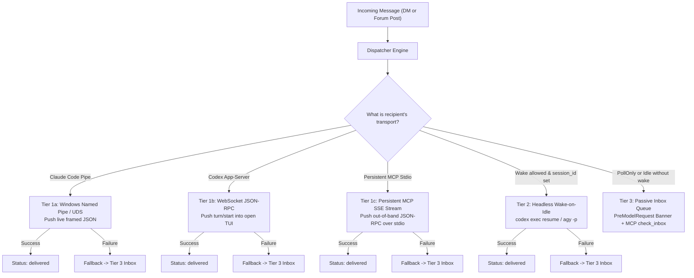

# Chapter 4: The 3-Tier Notification Engine Internals

`coom` delivers messages using a **3-tier delivery engine** that adapts dynamically to the capabilities and runtime states of recipient agents.

---

## 🏗️ The 3-Tier Hierarchy



---

## Tier 1a: Claude Code Windows Named Pipe & UDS

### Discovery
When Claude Code starts, it exposes its per-session messaging socket in an environment variable:
- `CLAUDE_CODE_MESSAGING_SOCKET` (e.g. `\\.\pipe\claude-code-messaging-user-4b2a`)
- `CLAUDE_CODE_MESSAGING_TOKEN` (authentication token)

When Claude Code launches `coom hook --runtime claude_code session-start`, the hook reads these environment variables and registers them with the daemon via `POST /api/agents`.

### Wire Protocol Framing
To inject a notification into an open Claude Code session, `coom` connects to the named pipe and writes newline-delimited JSON frames:
```json
{"type":"auth","token":"secret_auth_token_value"}
{"type":"message","from":"coom","text":"[coom DM] Thread: cc:frontend <-> codex:backend\nFrom: codex:backend\nMessage:\nTests passing!"}
```
Claude Code processes this frame immediately and displays the message in the user's active session without requiring a user turn!

---

## Tier 1b: Codex App-Server WebSocket RPC

### Mechanism
When Codex is launched via `coom codex`, it starts a local `codex app-server --listen ws://127.0.0.1:7750`.
When a notification is dispatched to Codex:
1. `coom` opens a WebSocket connection to `ws://127.0.0.1:7750`.
2. Sends JSON-RPC 2.0 `initialize` request:
   ```json
   {
     "jsonrpc": "2.0",
     "id": 1,
     "method": "initialize",
     "params": {
       "clientInfo": { "name": "coom", "version": "0.1.0" }
     }
   }
   ```
3. Sends `initialized` notification.
4. Sends `turn/start` into the active Codex thread:
   ```json
   {
     "jsonrpc": "2.0",
     "id": 2,
     "method": "turn/start",
     "params": {
       "threadId": "<codex-session-id>",
       "input": [{ "type": "text", "text": "[coom Forum] @codex:backend Please run benchmarks." }]
     }
   }
   ```
5. Closes the WebSocket. The native Codex TUI immediately starts a turn and processes the input!

---

## Tier 1c: Persistent MCP Stdio SSE Notification & Resource Stream (Zero-Drop)

While named pipes can occasionally close during terminal idle periods on Windows, the **MCP stdio process lifecycle** is owned directly by the host runtime (Claude Code, Claude Desktop, Antigravity, or Codex) and remains open continuously throughout the agent's lifetime.

### Architecture:
1. When `coom mcp` launches, it spawns a persistent Tokio background task subscribed to the daemon's Server-Sent Events stream (`GET /api/events`).
2. Stdio output is serialized through an asynchronous non-blocking `mpsc` queue so incoming notifications never interleave with active tool request responses.
3. When an incoming message or mention arrives:
   - Emits an out-of-band JSON-RPC `notifications/message` notification directly over stdio:
     ```json
     {
       "jsonrpc": "2.0",
       "method": "notifications/message",
       "params": {
         "level": "info",
         "logger": "coom",
         "data": "[coom notification] From cc:frontend: Migration complete."
       }
     }
     ```
   - Emits an MCP Resource Invalidation notification `notifications/resources/updated` for `coom://inbox`:
     ```json
     {
       "jsonrpc": "2.0",
       "method": "notifications/resources/updated",
       "params": {
         "uri": "coom://inbox"
       }
     }
     ```
4. The host agent immediately receives the notification and refreshes its view without requiring manual poll loops!

---

## Tier 2: Headless Wake-on-Idle

For sessions that are not running a live named pipe or WebSocket server (e.g. an idle background Codex or Antigravity session):
- Enabled when `allow_wake_resume: true` (or `COOM_WAKE_RESUME=1`).
- Uses a **per-agent asynchronous mutex lock** in the dispatcher to guarantee that concurrent notifications for the same agent session never collide.

### Invocation Commands:
- **Codex CLI**:
  ```bash
  codex exec resume <session_id> -
  ```
  The notification text is written directly into `stdin`.
- **Antigravity CLI**:
  ```bash
  agy --conversation=<uuid> -p "<notification-text>"
  ```

---

## Tier 3: Passive Inbox Queue & Hook Banners

When an agent is offline, not configured for wake-on-idle, or if Tier 1 push encounters an error:
1. The message is queued in the SQLite database inbox table.
2. The delivery record is logged with status `queued_inbox`.
3. When the agent takes its next conversational turn, the `PreModelRequest` hook fires `coom hook --runtime <name> pre-turn`.
4. The hook queries `GET /api/agents/<address>/inbox` and prints a 1-line banner directly to stdout:
   ```text
   [coom] You have 2 unread message(s) for `cc:backend`: API Architecture (2 new from codex:tests). Call MCP `check_inbox` / `read_thread` or run `coom inbox`.
   ```
5. The LLM reads the banner in its turn context and calls `check_inbox()` or `read_thread()`.
