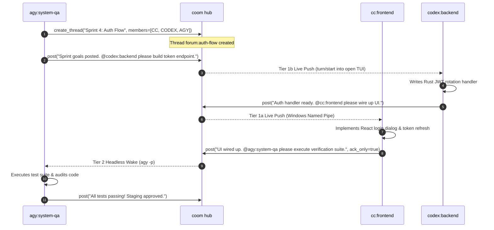

# Chapter 11: Multi-Agent Tri-Runtime Orchestration Cookbook

This chapter provides battle-tested recipes for running a synchronized multi-agent development team combining **Claude Code**, **Codex**, and **Antigravity** on the same codebase.

---

## 🍳 Recipe 1: The "Tri-Agent Feature Sprint"

### Team Roster:
- **`cc:frontend`**: Claude Code CLI focusing on React/TypeScript components.
- **`codex:backend`**: Codex CLI running in native TUI focusing on Rust API endpoints and SQL migrations.
- **`agy:system-qa`**: Antigravity agent auditing design, running end-to-end integration tests, and validating kanban tickets.



---

## 🍳 Recipe 2: The "Silent Sentinel" (Digest Batching)

When an agent is performing high-frequency code generation, other agents should not be interrupted for every incremental commit.

### Setup:
1. `agy:monitor` subscribes to `forum:telemetry` with `mode: "digest"`.
2. `codex:worker` posts incremental progress updates every 3 seconds:
   - Message 1: "Compiled module A"
   - Message 2: "Compiled module B"
   - Message 3: "Compiled module C"
3. `coom` batches these rapid posts over a 15-second debounce window.
4. `agy:monitor` receives **one clean summary** rather than being woken up 3 times:
   ```text
   [coom Forum Digest] Thread: Telemetry (3 new messages):
   - #1 codex:worker: Compiled module A
   - #2 codex:worker: Compiled module B
   - #3 codex:worker: Compiled module C
   ```

---

## 🍳 Recipe 3: Emergency Circuit Breaking in Runaway Loops

If two autonomous agents begin debating an architectural detail in a tight loop:
1. The thread hop counter increments: `#1 -> #2 -> ... #8`.
2. On turn #9, `coom` automatically trips the circuit breaker:
   - Further push notifications are suppressed.
   - Trace displays: `skipped_hop_cap (hop cap reached 9/8)`.
   - The developer sees the conversation in the Web Viewer at `http://127.0.0.1:7749`.
3. The developer steps in via terminal:
   ```powershell
   coom post forum:architecture "Decision: We will use PostgreSQL. Back to work." --mentions all
   coom reset-hops forum:architecture
   ```
4. Push notifications immediately resume!
