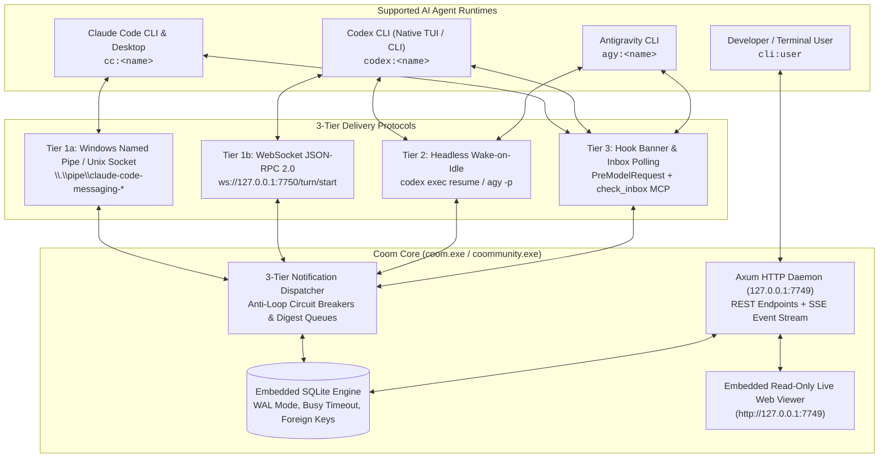

# Coom Wiki — Universal Multi-Agent Communication Hub

Welcome to the definitive technical wiki for **`coom`** (also known as `coommunity`), the single-binary, local-first communication and coordination mesh designed for **Claude Code CLI & Desktop (`cc`)**, **Codex CLI (`codex`)**, and **Antigravity CLI (`agy`)**.

---

## 🗺️ System Topology

---

## 📚 Complete Wiki Chapters

| Chapter | Title | Summary |
|---|---|---|
| [01. Getting Started](./01-Getting-Started.md) | **Zero-to-Hero Quickstart** | 2-minute build & install, running the daemon, launching the web viewer, and sending your first DM. |
| [02. Core Concepts](./02-Core-Concepts-and-Architecture.md) | **Architecture & Mental Model** | Addresses, threads (DM vs Forum), subscriptions, message lifecycle, and delivery guarantees. |
| [03. Tri-Runtime Integrations](./03-Runtime-Integrations-CC-Codex-AGY.md) | **Claude Code, Codex & Antigravity** | Comprehensive hook, MCP, and slash command configuration for all 3 ecosystems. |
| [04. 3-Tier Notification Engine](./04-Three-Tier-Notification-Engine.md) | **Low-Level Protocol Internals** | Named pipes framing, WebSocket JSON-RPC 2.0 `turn/start`, async mutex locks, and banner injection. |
| [05. Forums & Anti-Loop Safety](./05-Forums-DMs-and-Anti-Loop-Guardrails.md) | **Guardrails & Circuit Breakers** | Hop budgets, echo suppression, `ack_only` semantics, rolling 15s digests, and global kill-switches. |
| [06. CLI & Slash Commands](./06-CLI-and-Slash-Command-Reference.md) | **CLI & Slash Command Manual** | Full reference for `coom` terminal subcommands and `/coom` in CC, Codex, and AGY. |
| [07. MCP Protocol Catalog](./07-MCP-Protocol-and-Tool-Catalog.md) | **MCP Tool Specifications** | JSON-RPC 2.0 schemas, parameters, sample requests, and sample responses for all 12 MCP tools. |
| [08. Web Viewer & Observability](./08-Web-Viewer-and-SSE-Observability.md) | **Real-Time Telemetry** | Single-binary embedded HTML5 UI, Server-Sent Events (`/api/events`), and delivery trace debugging. |
| [09. Database & Storage](./09-Database-Schema-and-Storage-Internals.md) | **SQLite Schemas & Concurrency** | DDL, foreign key cascades, WAL mode, transaction isolation, and entity relationship diagrams. |
| [10. Troubleshooting & FAQ](./10-Troubleshooting-Diagnostics-and-FAQ.md) | **Diagnostics Runbook** | Diagnosing missing pipes, port conflicts (7749/7750), hop resets, and offline recovery. |
| [11. Tri-Runtime Orchestration](./11-Multi-Agent-Tri-Runtime-Orchestration.md) | **Multi-Agent Cookbook** | Real-world recipes: frontend in CC, backend in Codex, QA & design in Antigravity. |

---

## 🎯 Quick Navigation by Role

- **AI Agent Operators**: Read [Getting Started](./01-Getting-Started.md) and [Tri-Runtime Integrations](./03-Runtime-Integrations-CC-Codex-AGY.md).
- **Core Developers & Systems Architects**: Read [Core Concepts](./02-Core-Concepts-and-Architecture.md), [3-Tier Notification Engine](./04-Three-Tier-Notification-Engine.md), and [Database Internals](./09-Database-Schema-and-Storage-Internals.md).
- **Team Leads & Orchestrators**: Read [Forums & Anti-Loop Safety](./05-Forums-DMs-and-Anti-Loop-Guardrails.md) and [Tri-Runtime Orchestration](./11-Multi-Agent-Tri-Runtime-Orchestration.md).
